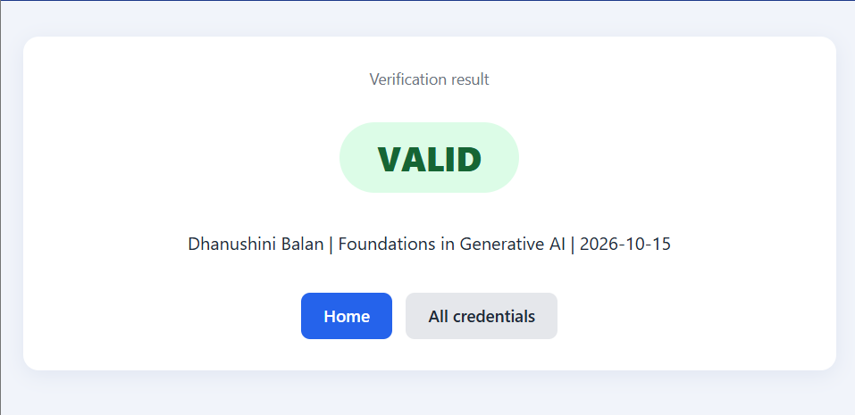
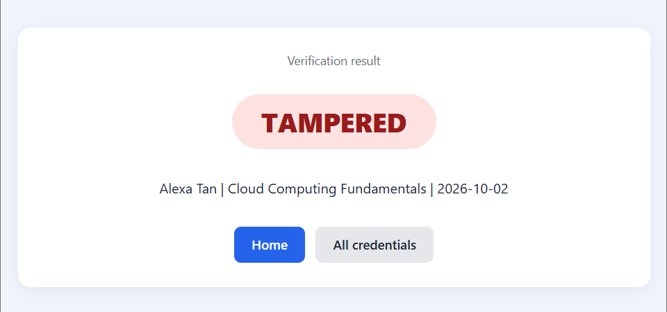
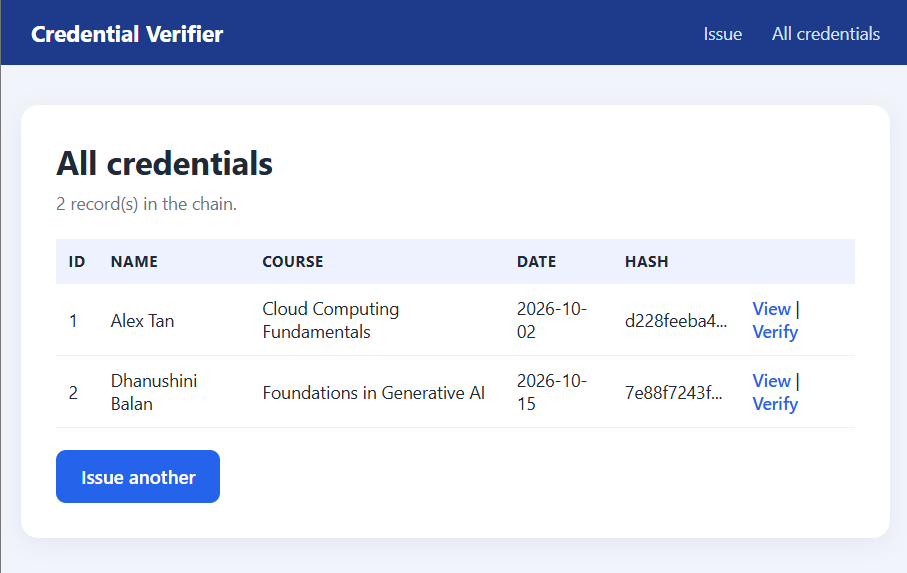

# Credential Verifier

A small web app that issues digital credentials and detects tampering.

## How it works
- Each credential (name, course, date) is hashed with SHA-256.
- Every record stores the previous record's hash, forming a hash chain.
- A QR code on each credential links to a verify page.
- If any record is edited, verification returns TAMPERED.

## Screenshots

## How to run
pip install flask "qrcode[pil]"
python app.py
Then open http://127.0.0.1:5000

## Future work
- Anchor credential hashes on an Ethereum testnet with a Solidity smart contract
- Support W3C Verifiable Credentials and DIDs

> Note: All data is sample data for demonstration only.